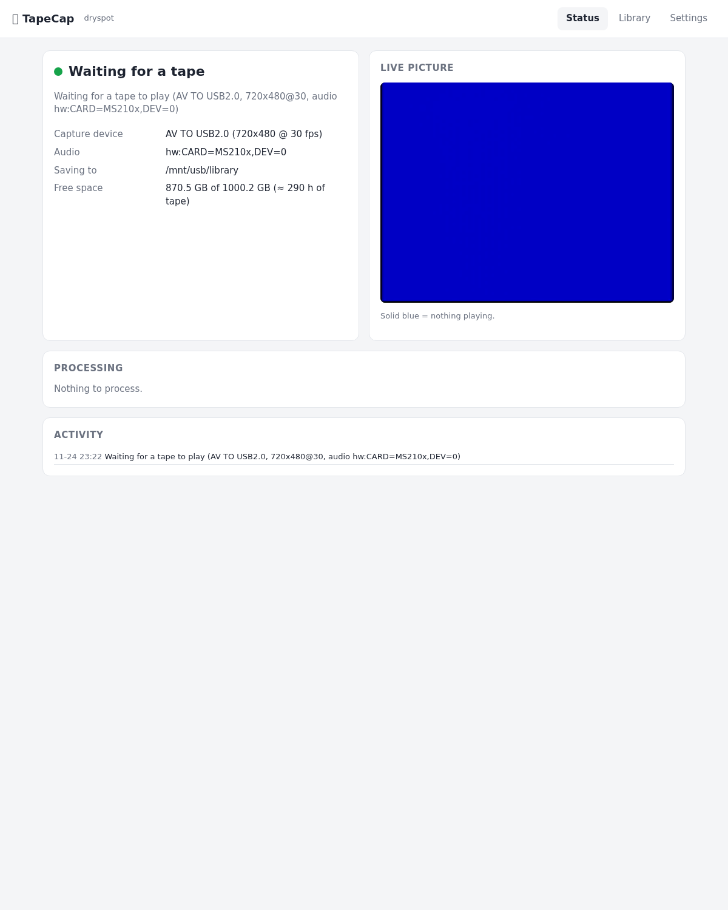
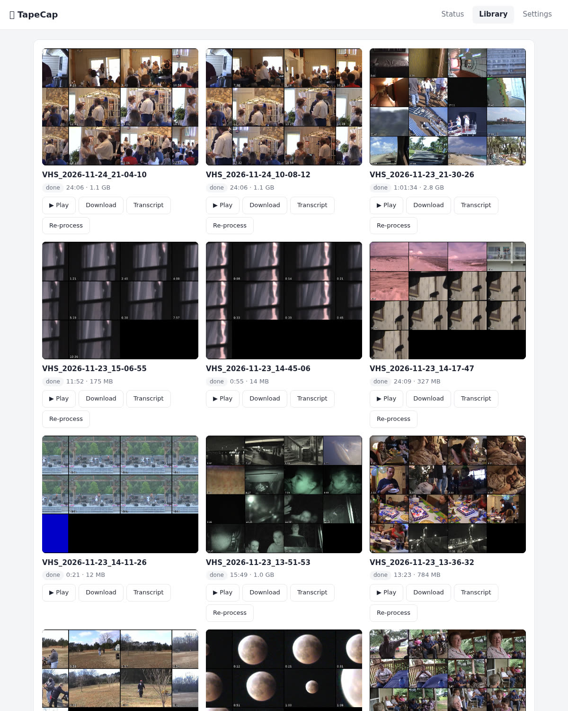
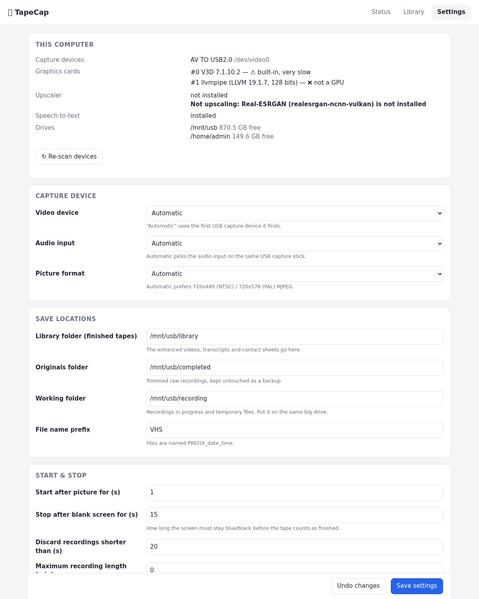

# 📼 TapeCap

**Automatic VHS / camcorder tape digitizer for Linux and the Raspberry Pi.**

Insert a tape, press **Play** and walk away. TapeCap notices the tape playing and records it. When the tape ends it trims off the blank part, then cleans up the picture and the sound. You end up with a ready-to-watch MP4 that has chapters, subtitles and a transcript. On a computer with a supported graphics card it can also AI-upscale the video.

A built-in web **control panel** shows the live picture and progress, and lets you watch the results or change any setting from your phone or computer.



---

## Features

| | |
|---|---|
| 🔌 **Automatic device detection** | Finds the USB capture stick and its matching audio input at startup. It also handles unplugging and re-plugging. |
| ▶️ **Hands-free recording** | Starts within a second of a tape playing and stops when the screen goes blank (blue/black). No buttons to press. |
| ✂️ **Blank-end trimming** | Removes the blue/black tail after the tape ends. |
| 🔊 **Sound enhancement** | Removes rumble and wind noise, reduces tape hiss, and evens the loudness out to streaming level (−14 LUFS). |
| 🎥 **Video stabilization** | Two-pass stabilization (vid.stab) smooths out handheld camcorder shake. |
| 📐 **Picture correction** | Crops the black edges and fixes the shape to a true 4:3 (capture sticks produce a picture 12 % too wide). |
| 🚀 **AI upscaling (optional)** | Real-ESRGAN upscaling (2×/3×/4×) when the computer has a supported Vulkan GPU, using more than one card if available. |
| 💬 **Transcripts & subtitles** | Offline speech-to-text with faster-whisper. Subtitles are embedded in the MP4 and also saved as `.srt` and `.txt`. |
| 📑 **Chapters & contact sheet** | Chapters at each camera stop/start point, plus a thumbnail sheet for every tape. |
| 🖥️ **Web control panel** | Status, live preview, stop button, processing progress, library with in-browser playback, and all settings. |
| 📱 **Phone notifications** | Optional Telegram (or other) messages through Hermes Agent when a tape finishes and when it has been processed. |
| ♻️ **Crash-safe** | Recordings cut short by a crash or power cut are recovered. Interrupted processing resumes where it stopped. |

## Quick start

```bash
git clone https://github.com/MaximusBalzac/tapecap.git
cd tapecap
./install.sh
```

Then open **`http://<computer-name>.local:8787/`** in a browser, plug in the capture stick, and play a tape.

Requirements:
- Debian, Ubuntu or Raspberry Pi OS (64-bit)
- a USB composite capture stick
- a VCR or camcorder

See **[Installation](docs/installation.md)** for details.

## How a tape flows through TapeCap

```
 VCR / camcorder ──RCA──► USB capture stick ──► TapeCap
                                                 │
   blue screen ── waiting ──► picture appears ──► RECORD (H.264 + AAC)
                                                 │
                                   15 s of blue ─┘──► trim + normalise ──► originals/VHS_<date>_<time>.mp4
                                                                              │
                         background processing (low priority) ◄───────────────┘
   crop ─► chapters ─► transcript ─► contact sheet ─► stabilize + clean sound ─► [AI upscale] ─► library/VHS_…/
```

## The library

Every tape gets its own folder with the finished video, subtitles, transcript, contact sheet and an info file. You can browse and play them all from the panel:



## Documentation

| Guide | What's in it |
|---|---|
| [Installation](docs/installation.md) | Requirements, installing, updating, uninstalling, running more than one machine |
| [Using TapeCap](docs/using-tapecap.md) | Everyday use, the control panel page by page, output files |
| [Configuration](docs/configuration.md) | Every setting explained, with defaults and tips |
| [Hardware guide](docs/hardware.md) | Capture sticks, cabling, Raspberry Pi vs PC, GPUs for upscaling (incl. old NVIDIA cards) |
| [Upscaling](docs/upscaling.md) | How AI upscaling works, choosing a model, speed expectations, multi-GPU |
| [How it works](docs/how-it-works.md) | Architecture, the detection algorithm, every processing step, file layout |
| [API reference](docs/api.md) | HTTP/JSON API used by the panel; for scripts and automation |
| [Notifications](docs/notifications.md) | Telegram (and other) alerts through Hermes Agent |
| [Troubleshooting & FAQ](docs/troubleshooting.md) | Common problems and fixes |
| [Development](docs/development.md) | Code layout, running from source, testing without a tape deck |



## License

[MIT](LICENSE)
