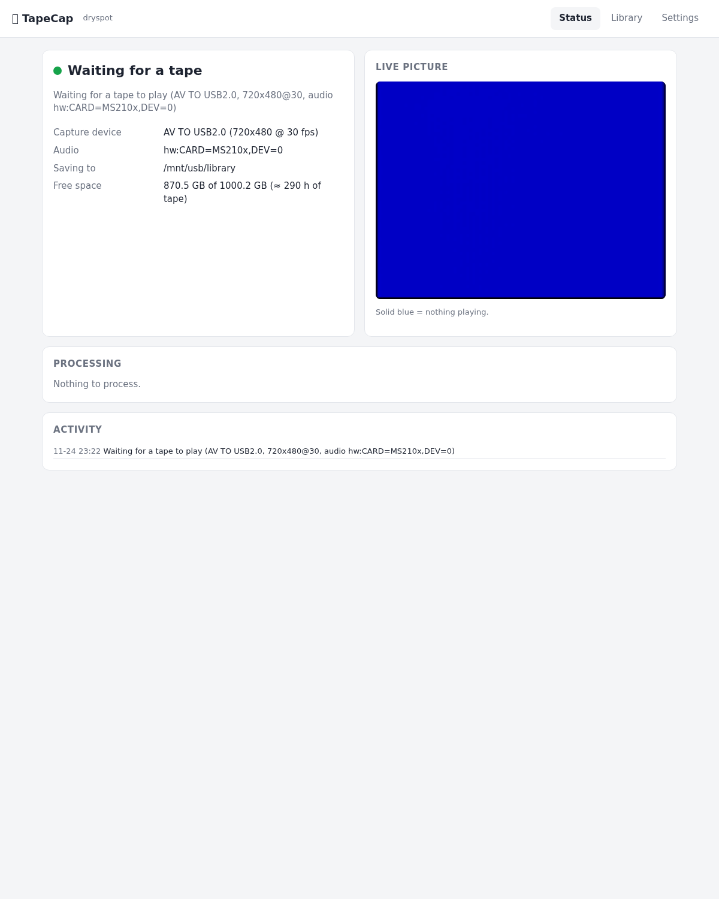
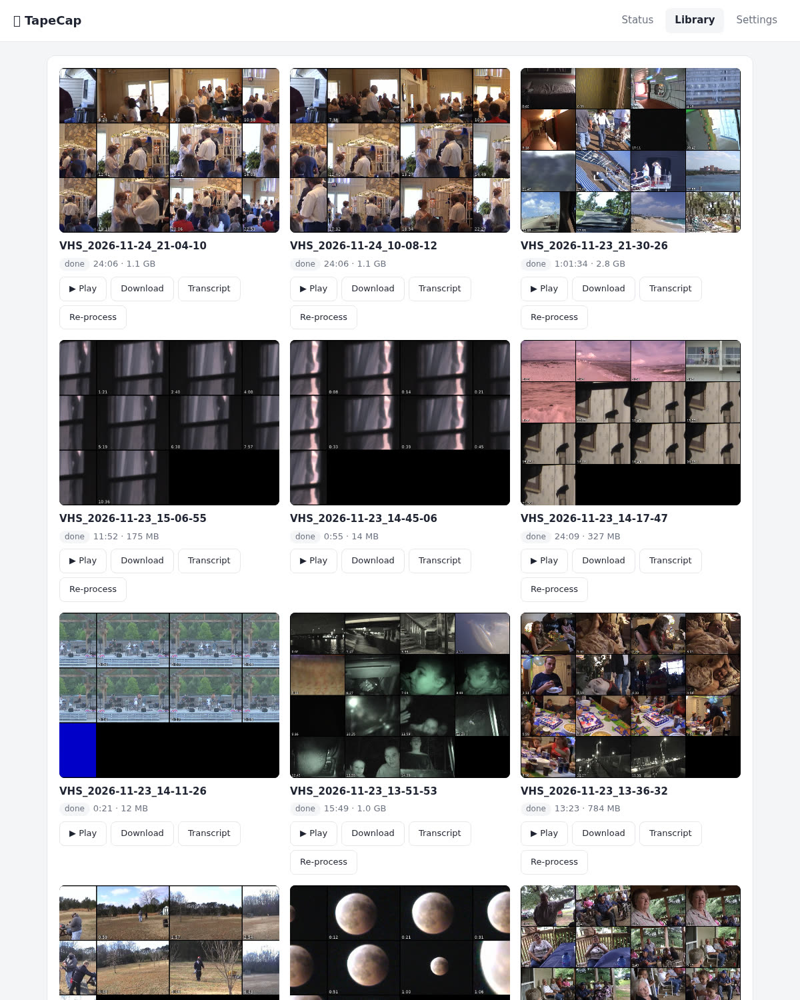
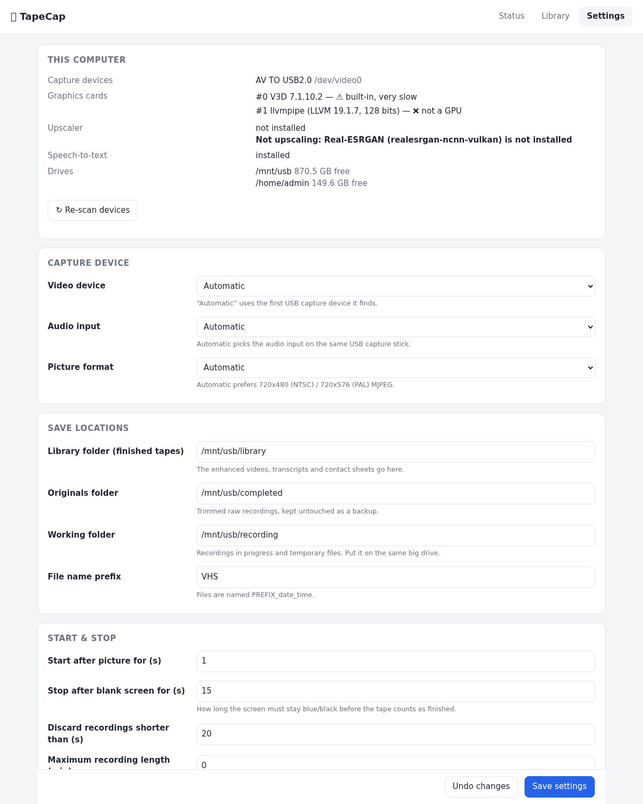

# Using TapeCap

## Everyday use

1. Connect the VCR or camcorder to the capture stick:
   - **yellow** RCA cable to video
   - **red/white** RCA cables to audio
2. Insert a tape. Rewind it if needed.
3. Press **Play** and walk away.

What happens next:
- **Within about 1 second** of a picture appearing, TapeCap starts recording.
- When the tape ends and the screen stays blue/black for **15 seconds**, it stops, trims off the blank part and saves the original.
- If you've set up [notifications](notifications.md), you get a message: *"Tape finished recording – ready for the next tape"*.
- Processing then runs in the background. You can put in the next tape straight away: recording always has priority, and processing works through tapes one at a time.
- When processing finishes, the tape appears in the **Library** (and you get a *"✅ Tape processed"* message).

> **Tip:** Turn on your VCR's **blue background / blue back** setting if it has one. Most VCRs show blue when a tape ends; some show snow (static) instead, and snow counts as "picture". If yours does that, set a *Maximum recording length* in Settings, or press **Stop recording** in the panel.

### Tapes with several recordings on them

A blank gap of **less than 15 seconds** between recordings is recorded straight through. A longer gap ends the file, and the next recording on the tape starts a new one. Nothing is lost: you just get several files from one tape. Change *Stop after blank screen for* to adjust this.

### How long things take

On a Raspberry Pi 5, with speech transcription on the `small.en` model:

| Step | Time |
|---|---|
| Recording | real time (a 60-minute tape takes 60 minutes) |
| Trimming + saving | about 1–4 minutes |
| Processing | about **1.3–2× the tape's length**. Tapes with lots of talking take the longest, because of transcription. |
| AI upscaling | depends entirely on the graphics card. See [Upscaling](upscaling.md). |

---

## The control panel

Open `http://<computer-name>.local:8787/`. It works on phones too. The address ends in `#status`, `#library` or `#settings`, so you can bookmark a tab.

### Status



| Item | Meaning |
|---|---|
| **State** | **Waiting for a tape** (green): idle, watching the input. **Recording** (red, blinking). **Saving…** (orange): trimming and normalising. **No capture device**. **Waiting for drive**: the save drive isn't mounted. **Problem**: see the message underneath. |
| **Recording time / size / blank screen** | Shown while recording. "Blank screen" counts up when the tape has ended; recording stops when it reaches the limit. |
| **Stop recording now** | Ends the recording immediately and saves everything recorded so far. |
| **Capture device / Audio** | The device and audio input in use, and the picture format. |
| **Free space** | Free space on the library drive, with a rough estimate of how many hours of tape still fit. |
| **Live picture** | What the capture stick sees right now, refreshed about every 1.5 s. Solid blue means no signal. |
| **Processing** | The tape being processed, the current step, progress bars, tapes waiting in the queue, the last result, and whether upscaling is used. **Cancel this tape** stops processing it; you can re-process it later from the Library. |
| **Activity** | A log of recent events: recordings started and stopped, files saved, problems. |

### Library



Every tape shows its contact sheet, length and size, with a status tag:

| Tag | Meaning |
|---|---|
| `done` | Processed and ready |
| `processing` | Being worked on right now |
| `queued` | Recorded, waiting its turn |
| `failed` | Processing failed. The error is shown; press **Retry**. |

Buttons:
- **▶ Play** (or click the contact sheet): plays the finished video in the browser, with subtitles. If the tape hasn't been processed yet, it plays the original.
- **Download**: saves the MP4 to your computer or phone.
- **Transcript**: opens the text transcript with timestamps.
- **Standard version**: only on upscaled tapes when *Also keep the standard version* is on.
- **Re-process**: runs the tape through processing again with the *current* settings, for example after changing stabilization strength. The library copy is replaced when it finishes. The original is never changed.

### Settings



The top card, **This computer**, shows what TapeCap found:
- capture devices
- graphics cards, and whether each can be used for upscaling
- whether the upscaler and speech-to-text are installed
- drives and their free space

Press **↻ Re-scan devices** after plugging something in.

Below that, every option is grouped by topic. See **[Configuration](configuration.md)** for what each one does. Press **Save settings** at the bottom:
- Invalid values are highlighted and nothing is saved.
- Folders are created and tested for write access before saving.
- Changes apply **immediately** if nothing is recording, or **after the current recording** if a tape is playing. Processing picks up the new settings at the start of the next tape.

---

## Output files

```
<Originals folder>/
  VHS_2026-11-23_00-04-16.mp4          trimmed, loudness-normalised capture (never modified again)
  VHS_2026-11-23_09-12-40_recovered.mp4  saved after a crash/power cut

<Library folder>/
  .processed.json                      which originals are done (delete an entry to redo it)
  VHS_2026-11-23_00-04-16/
    VHS_2026-11-23_00-04-16.mp4        the finished video (upscaled, if upscaling ran)
    VHS_2026-11-23_00-04-16_SD.mp4     standard-resolution version (only when upscaled + kept)
    VHS_2026-11-23_00-04-16.srt        subtitles
    transcript.txt                     "[m:ss] text" lines
    contact_sheet.jpg                  thumbnail grid, one per chapter (8–16 images)
    info.txt                           length, capture date, picture size, chapter list
```

File names are `<prefix>_<date>_<time>` of when the recording **started**, which is the capture date, not the date the tape was filmed.

TapeCap tracks finished tapes by the original's file name. Renaming a library folder won't cause re-processing, but the Library page will then list the renamed folder and the original as two separate entries. If you want your own names, copy the finished files somewhere else (a Plex/Jellyfin library, for example) and rename them there.

### Playing the files elsewhere

The finished MP4s are standard H.264 + AAC and play almost everywhere: phones, smart TVs, VLC, Plex, Jellyfin and Windows/macOS players.
- **Chapters** show up in VLC, mpv, Plex and Jellyfin, and in QuickTime/IINA on the Mac.
- **Subtitles** are embedded as a text track that you can switch on in the player. For players that ignore embedded subtitles, the `.srt` next to the video is picked up automatically by VLC, Plex and Jellyfin.
